<!-- Generated by scripts/build_readme.py from scripts/profile.json. Edit those and run it again. -->

<a href="https://achyuthkp27.github.io/Portfolio/"><picture><source media="(prefers-color-scheme: light)" srcset="assets/readme/hero-light.svg">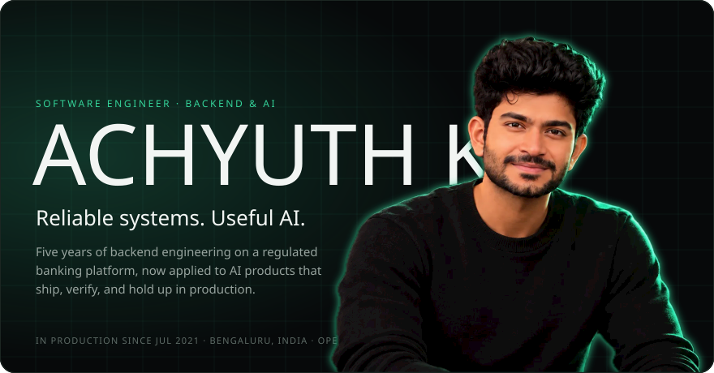</picture></a>

  <a href="https://achyuthkp27.github.io/Portfolio/"><picture><source media="(prefers-color-scheme: light)" srcset="assets/readme/btn-portfolio-light.svg"></picture></a>
  <a href="https://www.linkedin.com/in/kpachyuth"><picture><source media="(prefers-color-scheme: light)" srcset="assets/readme/btn-linkedin-light.svg"></picture></a>
  <a href="https://medium.com/@kpachyuthz"><picture><source media="(prefers-color-scheme: light)" srcset="assets/readme/btn-medium-light.svg"></picture></a>
  <a href="mailto:kpachyuthz@gmail.com"><picture><source media="(prefers-color-scheme: light)" srcset="assets/readme/btn-email-light.svg"></picture></a>
  <a href="https://achyuthkp27.github.io/Portfolio/achyuth-kp-resume.pdf"><picture><source media="(prefers-color-scheme: light)" srcset="assets/readme/btn-resume-light.svg">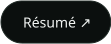</picture></a>

<picture><source media="(prefers-color-scheme: light)" srcset="assets/readme/h-tour-light.svg"></picture>

https://github.com/user-attachments/assets/05129d46-8ab1-48b7-bc1a-be3742382bd0

A 60-second tour of my portfolio. Music: "Cinematic Minimal Orchestral Percussion Trailer" by Gregor Quendel, <a href="https://creativecommons.org/licenses/by/4.0/">CC BY 4.0</a>.

<picture><source media="(prefers-color-scheme: light)" srcset="assets/readme/h-featured-light.svg"></picture>

<a href="https://achyuthkp27.github.io/Portfolio/"><picture><source media="(prefers-color-scheme: light)" srcset="assets/readme/featured-portfolio-light.svg">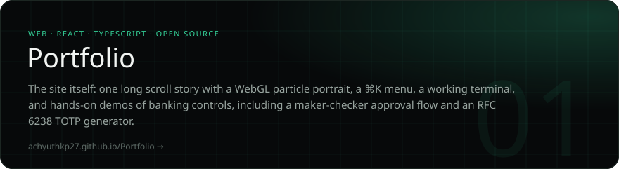</picture></a>

<a href="https://github.com/achyuthkp27/spring-ai-langchain4j"><picture><source media="(prefers-color-scheme: light)" srcset="assets/readme/featured-aegisai-light.svg">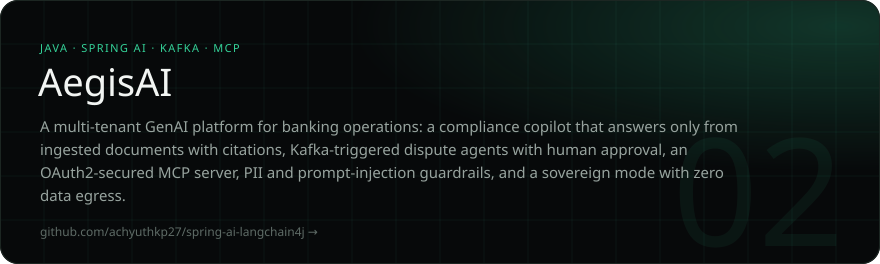</picture></a>

<a href="https://github.com/achyuthkp27/kairo-offline-ai-bank"><picture><source media="(prefers-color-scheme: light)" srcset="assets/readme/featured-kairo-light.svg">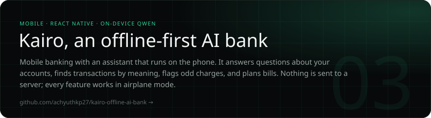</picture></a>

<a href="https://github.com/achyuthkp27/VoxOs"><picture><source media="(prefers-color-scheme: light)" srcset="assets/readme/featured-voxos-light.svg">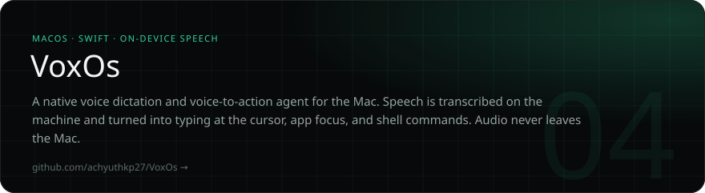</picture></a>

<picture><source media="(prefers-color-scheme: light)" srcset="assets/readme/h-more-light.svg"></picture>

  <a href="https://github.com/achyuthkp27/forge-fit"><picture><source media="(prefers-color-scheme: light)" srcset="assets/readme/card-forgefit-light.svg">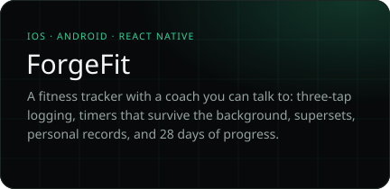</picture></a>
  <a href="https://github.com/achyuthkp27/cross-platform-kiosk-banking"><picture><source media="(prefers-color-scheme: light)" srcset="assets/readme/card-kiosk-light.svg">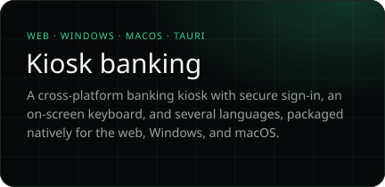</picture></a>
  <a href="https://github.com/achyuthkp27/ChatApp-Websocket"><picture><source media="(prefers-color-scheme: light)" srcset="assets/readme/card-chat-light.svg">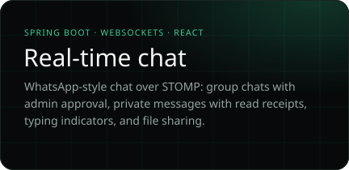</picture></a>
  <a href="https://github.com/achyuthkp27/ytTheme"><picture><source media="(prefers-color-scheme: light)" srcset="assets/readme/card-yttheme-light.svg">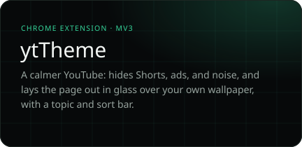</picture></a>

<picture><source media="(prefers-color-scheme: light)" srcset="assets/readme/h-experience-light.svg"></picture>

<picture><source media="(prefers-color-scheme: light)" srcset="assets/readme/experience-light.svg">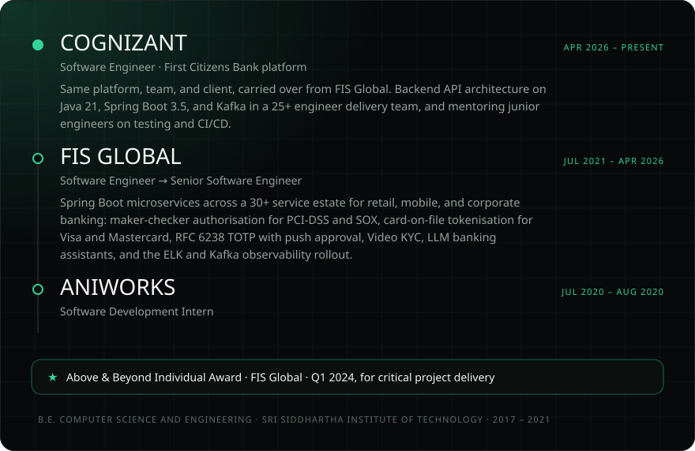</picture>

<picture><source media="(prefers-color-scheme: light)" srcset="assets/readme/h-stack-light.svg"></picture>

<picture><source media="(prefers-color-scheme: light)" srcset="assets/readme/stack-light.svg">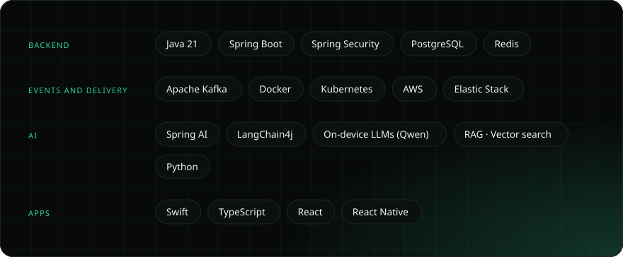</picture>

<picture><source media="(prefers-color-scheme: light)" srcset="assets/readme/h-about-light.svg"></picture>

<picture><source media="(prefers-color-scheme: light)" srcset="assets/readme/about-light.svg">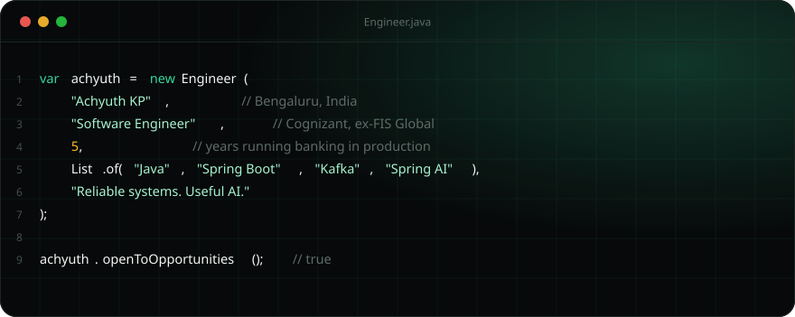</picture>

<picture><source media="(prefers-color-scheme: light)" srcset="assets/readme/h-writing-light.svg"></picture>

<!-- BLOG-POST-LIST:START -->
- [What is VPN and How it Works?](https://kpachyuthz.medium.com/what-is-vpn-and-how-it-works-3da8dcc0c1c5?source=rss-683f0581887c------2)
- [What is the difference between Virtual Reality, Augmented Reality, and Mixed Reality?](https://medium.com/the-narrow-world/what-is-the-difference-between-virtual-reality-augmented-reality-and-mixed-reality-fac2bff0551?source=rss-683f0581887c------2)
- [What is Artificial Intelligence?](https://medium.com/the-narrow-world/what-is-artificial-intelligence-1b7cc6731cc4?source=rss-683f0581887c------2)
- [What are the different types of Artificial Intelligence?](https://medium.com/the-narrow-world/what-are-the-different-types-of-artificial-intelligence-a5e5fdee92b8?source=rss-683f0581887c------2)
<!-- BLOG-POST-LIST:END -->

<picture><source media="(prefers-color-scheme: light)" srcset="assets/readme/h-github-light.svg"></picture>

  
  

<picture>
  <source media="(prefers-color-scheme: dark)" srcset="https://github.com/achyuthkp27/achyuthkp27/blob/output/github-contribution-grid-snake-dark.svg">
  <source media="(prefers-color-scheme: light)" srcset="https://github.com/achyuthkp27/achyuthkp27/blob/output/github-contribution-grid-snake.svg">
  
</picture>

<a href="https://achyuthkp27.github.io/Portfolio/#contact"><picture><source media="(prefers-color-scheme: light)" srcset="assets/readme/cta-light.svg">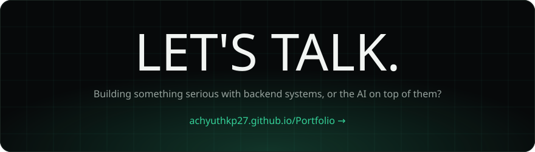</picture></a>
